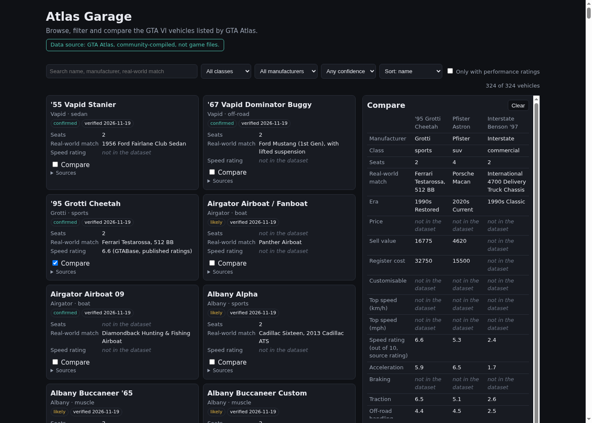

# Atlas Garage

Search, filter and compare 324 GTA VI vehicles, with source, confidence and last-verified date on every one.

A single-page browser app built on the GTA Atlas vehicle dataset.

**Data source: GTA Atlas, community-compiled, not game files.** The only data is `data/vehicles.json`, a snapshot of https://atlasgta.com/data/vehicles.json (324 vehicles, fetched 24 Nov 2026). Where the file has no value, the page says "not in the dataset". Nothing is estimated. Each vehicle shows Atlas's confidence and last-verified date.

## Use it

Open `index.html`, or serve the folder (it works from file:// and from a GitHub Pages sub-path; no install, no build step).

Optional URL parameters: `?q=cheetah` pre-fills the search, `?compare=slug1,slug2` pre-selects vehicles.

## What to expect from the data

Many fields are sparse in the source. Top speed and price are empty for every vehicle, and only 68 of 324 vehicles have the rating fields (speed, acceleration, traction, off-road handling, strength). The comparison shows those gaps rather than filling them.

## Credit and licence

Vehicle data: GTA Atlas (https://atlasgta.com), CC BY-SA 4.0. The manifest is kept as `data/atlas-manifest.json`.

This repository is released under CC BY-SA 4.0 (see `LICENSE`), matching the share-alike terms Atlas asks for.

Unofficial fan project. Not affiliated with, endorsed by or sponsored by Rockstar Games or Take-Two Interactive. Grand Theft Auto is a trademark of Take-Two Interactive. No game files, game assets, extracted data or mods are included, and the app installs or modifies nothing.
